# Anvil

The RuneLite companion for **[anvilosrs.com](https://anvilosrs.com)** — where OSRS clans run their
bingos, their weekly SotW/BotW competitions, and their roster.

You install it once and sign in. After that it does the boring half of an event for
you: your drops get screenshotted and filed against the right tile, your kill counts and XP move the
board as you earn them, and the things worth shouting about land in your clan's Discord.

<p align="center">
  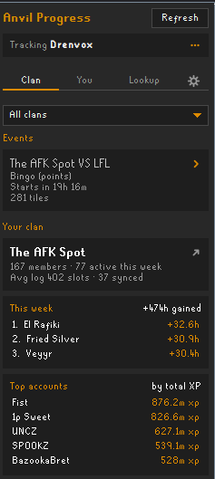
</p>

## Get set up in one click

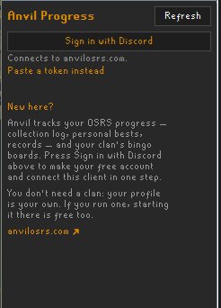

1. **Install** — RuneLite → Configuration (the wrench) → **Plugin Hub** → search **Anvil** → Install.
2. **Sign in** — open the Anvil side panel (the anvil icon on the right) and click **Sign in with
   Discord**. Approve the code in your browser and you're done.

That's it — there's nothing to type into settings. If the browser step won't work for you, copy your
token from **Profile → RuneLite plugin** on anvilosrs.com and use **Paste a token instead**, right
under the button.

One sign-in covers **every clan you're in** — there's no per-clan address and no per-event token.
To sign this computer out, open the **⋯** menu next to your name at the top of the panel.

<br clear="right">

Can't run the plugin? You can verify an account on the website instead — see the
**[player setup guide](https://anvilosrs.com/guide/plugin)**, which walks through all of this with
screenshots.

## What it does

**Files your drops for you.** When something lands that a tile is watching, the plugin takes the
screenshot, stamps it, uploads it and files it against your team's board. No clicks. Two frames go
into each drop shot by default — one as it lands, one once the loot has settled — because that's
what stops arguments.

**Moves the board live.** Boss kill counts and skill XP push as you earn them, so a KC or XP tile —
and any weekly competition you're in — updates the moment you get the kill, rather than on the next
hiscores sweep.

**Tracks the things that aren't drops.** NPC kill counts, item gains from catching and cooking and
gathering, timed clears, deathless raids, LMS placements, achievement-diary tiers, and Combat
Achievement tasks. CA tiles even count tasks you cleared years ago — turn on
*Settings → Combat Achievements → Repeat completion* in game and re-meeting the conditions credits
it.

**Proves it happened.** A codeword drawn daily by the site, plus a UTC timestamp, is drawn on screen
and baked into every screenshot — so evidence can't be quietly back-dated.

**Posts to your clan's Discord.** Deaths, PvP kills, rare and valuable drops, pets, combat
achievements, collection-log slots, level milestones, diaries and quests — most with a screenshot of
the moment. You choose what you send; your admins choose which channel it lands in.

<p align="center">
  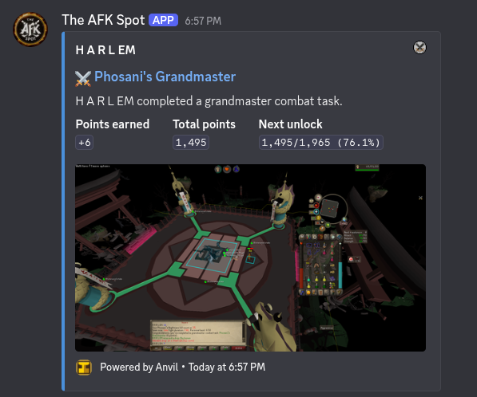
  &nbsp;
  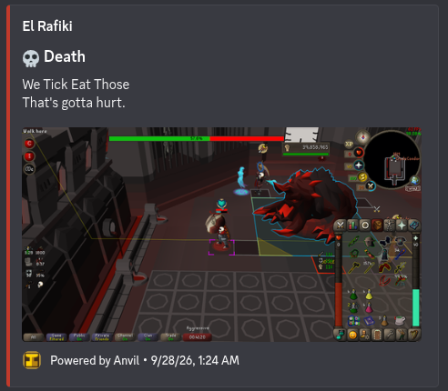
</p>

**Keeps your profile current.** Your collection log and personal bests sync to the site, so your
profile there shows what you've actually done.

## The side panel

The top of the panel says which character is being tracked. Started from the Jagex Launcher, it
already knows who's about to log in, so your clan's events and board are there at the login screen —
before you've pressed Play.

Three tabs: **Clan** for your events and your clan, **You** for your own profile, and **Lookup** for
anyone else's. The gear opens the panel's own controls — profile and roster sync, and your banner and
mission sounds.

### Clan

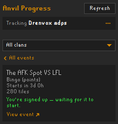

**Your events.** Every live and upcoming bingo and weekly competition for the clan you're looking at,
with where you stand: signed up, waiting on approval, or your placing in this week's SotW/BotW.
Several clans? Switch between them from the dropdown, or leave it on **All clans**.

**The whole board, searchable.** Open an event and every revealed tile is listed — search it by name or
by kind (`timed`, `kill`, `drop`…). Each tile shows who on your team is planning to go for it.

<br clear="right">

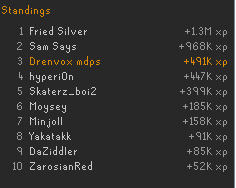

**This week, at a glance.** A weekly competition shows its live standings, with you highlighted, and
your clan's card shows the week's top gains and its biggest accounts.

<br clear="right">

<p align="center">
  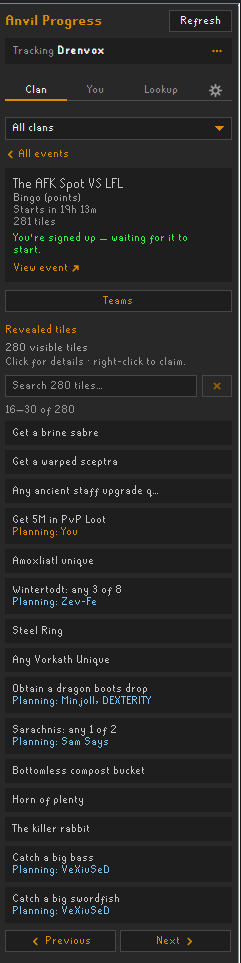
  &nbsp;
  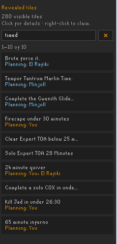
  &nbsp;
  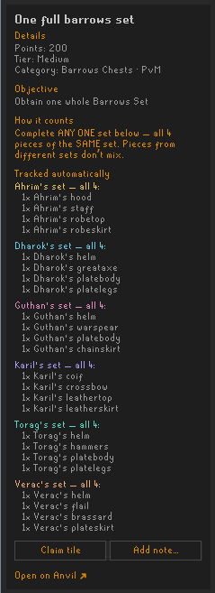
  &nbsp;
  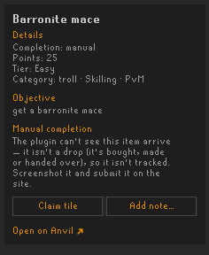
</p>

**What each tile wants.** Click a tile for its points, objective and *how it counts* — every set and
item the plugin is watching for, or, for a tile it can't see (bought or handed-over items), a plain
note to screenshot it and submit it on the site.

**Claim it.** Right-click a tile (or use **Claim tile** in its detail) to tell your team you're going
for it, with an optional note — change the note or drop the claim from the same place. Claiming needs
you logged in as the character on the team.

**Track it on screen.** **Track on screen** in a tile's detail (or its right-click menu) pins a live
widget over the game: your team's bar with its top contributors, and how every other team stands on
the same tile. Alt+drag it to move or resize it; pin up to three. Your own kills show a few seconds
after they happen, everyone else's within half a minute. Pin them before the event starts and they
count down, then go live at the whistle. When your team finishes a pinned tile it shows Done for a moment, then
takes itself down (a tile you pin after it's already done stays up).

**Find the starting spot.** While your starting shot is owed, an on-screen card shows where to stand
and its live checks, and a hint arrow and a world map pin point to the drawn spot. Once the shot is
filed the card says you're tracked and goes away. **Route me there** on the starting-shot card draws the whole way with the
[Shortest Path](https://runelite.net/plugin-hub/show/shortest-path) plugin, if you have it.

**Who's on which team.** The **Teams** button on an event lists the teams ranked, with yours on top;
open one for its roster, captain first, or search for anyone across every team. Click a name to look
them up.

<p align="center">
  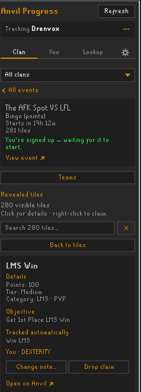
  &nbsp;
  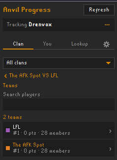
  &nbsp;
  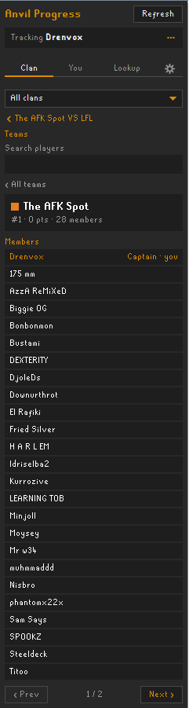
</p>

**Not your account?** If someone else plays a character on your RuneLite — a sibling, a friend — open
the **⋯** menu and pick **Not my account**. Nothing is sent for that character on this computer
until you press **Track again** in the same strip.

### You

Your own profile, without leaving the game: total level, combat and account type, your collection log
by category down to each page's items and how many of each you have, your latest unlocks, skills,
bosses, clues and best times, and the goals you've set on the site with their deadlines.

<p align="center">
  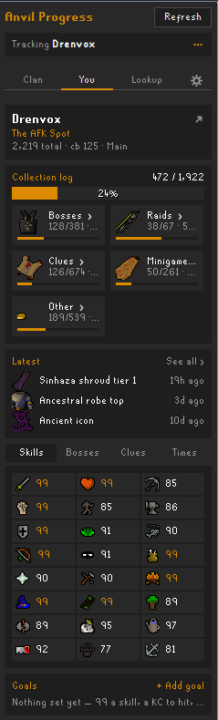
  &nbsp;
  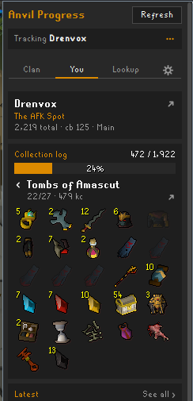
</p>

### Look anyone up

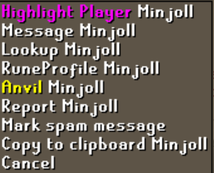

Right-click a player — standing next to you, or by name in chat, your friends list or the clan
panel — and pick **Anvil** to open their card in the side panel's **Lookup** tab. Your own is the
**You** tab. On a name in chat it's never the left-click option, so clicking a name still does what
the game does.

Rather keep your menus short? Pick where it shows under **Player lookup** in the settings, or untick
**Anvil lookup on players** to hide it everywhere.

<br clear="right">

Or search by name in the **Lookup** tab — players or clans. A player's card is the same profile the
You tab shows you; **Compare with me** lines the two of you up skill by skill, boss by boss and page by
page. A clan's card shows its size, how active it is this week and who's gaining most.

<p align="center">
  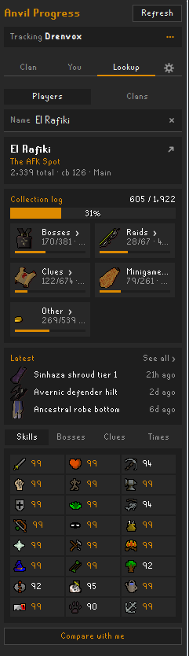
  &nbsp;
  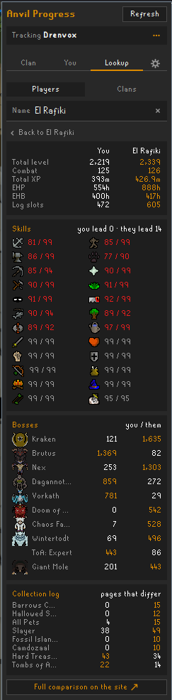
  &nbsp;
  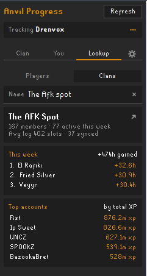
</p>

### In-game, where you already are

An **Anvil** button sits in the collection log's title bar next to WikiSync and RuneProfile — one
click syncs your log and your best times.

<p align="center">
  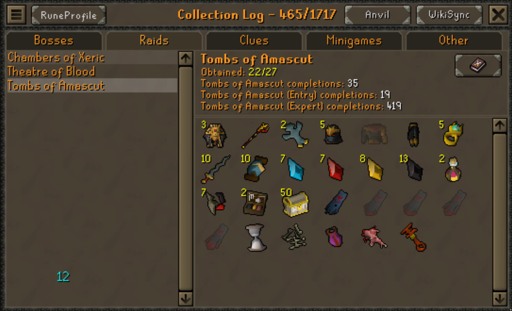
</p>

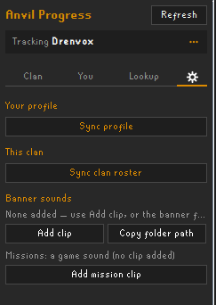

The same sync is on the panel's gear page, with your banner and mission sounds: **Add clip** for a
.wav to play when a tile completes, and a separate one for missions.

<br clear="right">

The same button is in the clan window. If you're an admin or a moderator it pushes the in-game clan
roster to the site, keeping ranks and guest/member status right without anyone typing a list out.

<p align="center">
  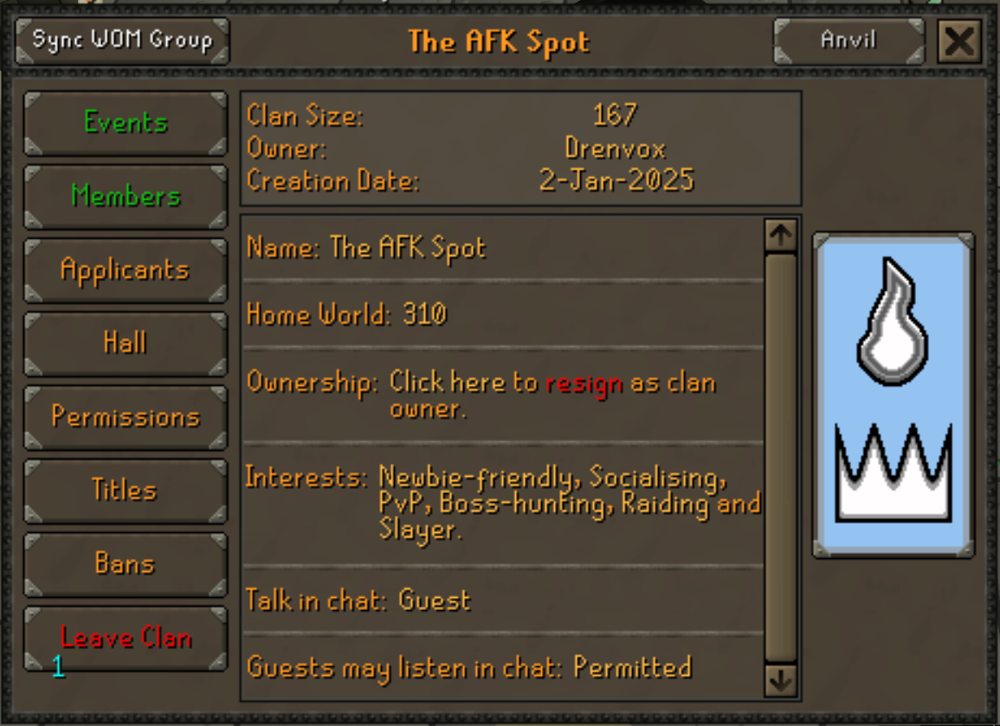
</p>

## Settings

Defaults are sensible — you can install it, sign in and never open this again. Signing in and out
lives in the side panel, not here. Every setting has a description in the plugin itself; this is the
shape of it.

| Section | What's in it |
| --- | --- |
| **Player lookup** | The **Anvil** entry on player names, and where it shows: players in the world, the chatbox and private messages, clan panels, friends chat, and your friends, ignore and party lists. In chat it's never the left-click option. |
| **Bingo** | The verification overlay, team and personal tile popups, banner sounds, the automatic starting shot and its on-screen guide. |
| **Notifications: Deaths & kills** | Your death posts and your own death message; PvP kills (off by default). |
| **Notifications: Drops & pets** | Rare drops by value or by rarity, loot keys, and pets. Each posts with a screenshot. |
| **Notifications: Combat achievements** | CA tasks and tier clears, collection-log slots, level milestones (your clan's rules), diaries (with a screenshot), quests by difficulty. |
| **Profile sync** | Clan Coffer movements, collection log, personal bests, clan roster, and sharing highlights with the clan. |

<p align="center">
  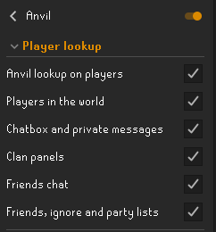
  <br>
  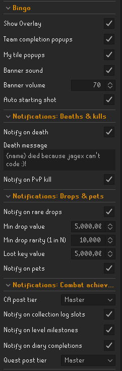
</p>

A few worth knowing about:

| Setting | Default | Why you'd change it |
| --- | --- | --- |
| Anvil lookup on players | on | Turn it off to keep **Anvil** out of every menu, or untick just the places you don't want it under **Player lookup**. |
| Show Overlay | on | Turn it off if you don't want the codeword panel on screen — proofs are still stamped. |
| Min drop value | 5,000,000 | The gp floor for a drop post. `0` switches value posts off. |
| Min drop rarity (1 in N) | 10,000 | Catches cheap-but-rare uniques. Looser than this and the channel fills with herb rolls. Your clan can set a floor; yours applies when it's stricter. |
| Loot key value | 1,000,000 | A loot key posts once, for its whole contents. |
| CA post tier | Master | The lowest task tier that posts, tier clears included. Grandmaster for only the rarest, **Off** for none. Bingo CA tiles count either way. |
| Quest post tier | Master | Quests at or above this difficulty, from **All** to Grandmaster, or **Off**. |
| Notify on level milestones | on | Which levels post is your clan's call (99s and high totals by default). Post less, or set your own rules for your personal webhooks, under Announcements on your Anvil profile. |
| Notify on PvP kill | off | On, and your kills post with a screenshot of the tick they hit 0 HP. |

### Profile sync

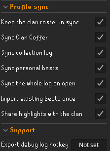

Your collection log and personal bests, kept current on your profile. The whole log syncs when you
open it in game, or on the **Sync profile** button the side panel shows while the log is open. **Share highlights with the
clan** is what puts your pets, big drops and combat tasks on the clan's feed.

<br clear="right">

## In-game settings it leans on

The plugin says so in chat when one of these is off and it matters:

- **Loot drop notifications** (Settings → Chat) — the only signal for bosses whose loot spills out of
  a corpse rather than dropping. Keep its threshold at or below your Min drop value.
- **Combat Achievements → Repeat completion** — lets CA tiles count tasks you finished before the
  event.
- **Collection log → New addition notification** — credits shop, gamble and awarded log items that
  never fire a loot event.

## When something breaks

The plugin tells you in chat when tracking stops, and why. Nothing to check on a dashboard.

Failed submissions are kept on disk and retried with backoff, so a dropped connection or a server
restart doesn't lose a drop.

A pet or Champion's scroll you already own only gives the game's "funny feeling" line, which never
says which one. The plugin works it out from what you just killed or trained, credits the tile, and
flags it so event staff take a look. When it can't be sure, the screenshot is saved for you to attach
on the site instead of scrambling for a shot after the fact.

A few things can't be tracked perfectly, almost always because of what the game reports — multi-target
kills, repeat combat achievements, storage like fish barrels. They're listed, with what to do instead,
under **[Known limitations](https://anvilosrs.com/guide/plugin#limits)** in the player guide.

Still stuck? Ask your clan admin, or bring it to the
**[Anvil support Discord](https://discord.gg/p9NkrTQmxN)**, where you can ask anything about the plugin
or the site.

## Guides

Written against the live site, with screenshots:

- **[Player setup](https://anvilosrs.com/guide/plugin)** — this, in detail
- **[Captain's guide](https://anvilosrs.com/guide/captain)** — reading the pool, draft day, running a team
- **[Running your first event](https://anvilosrs.com/guide/admin)** — for clan staff, start to finish
- **[Formats, and how tiles open](https://anvilosrs.com/guide/formats)** — board shapes and reveal rules
- **[Building a board that tracks itself](https://anvilosrs.com/guide/board)** — what each tile kind can see
- **[Hosting a visiting clan](https://anvilosrs.com/guide/clan-vs-clan)** — clan-v-clan without collecting RSNs by hand
- **[On the rota](https://anvilosrs.com/guide/moderator)** — verifying submissions and accounts
- **[Fees and payouts](https://anvilosrs.com/guide/fees)** — entry fees through to paid placements

All of them are available in 16 languages — pick one from the top of any guide page.

Questions, bugs or ideas: **[join the Anvil support Discord](https://discord.gg/p9NkrTQmxN)**.

## How Anvil connects

Anvil connects to **anvilosrs.com** after you sign in:

- **Anvil is a third-party site.** anvilosrs.com isn't run by RuneLite or Jagex — it's where your clan's
  events, boards and rosters live.
- **The plugin has to talk to it.** Filing a drop against a tile, moving the board with your KC and XP,
  or syncing your collection log are all web requests to anvilosrs.com — and any web request shows the
  server your IP address. The plugin doesn't collect it separately.
- **What's sent is your own play.** Your RSN, in-game Clan Coffer balance changes while you have it
  open, and the drops, kill counts, XP and progress of the
  account you're logged into, for the clans and events you're in — tied to your Account Token. The IP
  address is used the way any website uses it: to answer the request and to rate-limit abuse.
- **Nothing is sent until you sign in.** A fresh install contacts nobody until you click **Sign in**.

## Privacy

- The plugin only ever talks to **anvilosrs.com**, and only once you've signed in. It refuses to
  open a sign-in page anywhere else, and nothing goes to any other third party.
- Screenshots upload only when a tracked drop is detected, or when you ask for one.
- Your Account Token is stored locally in your RuneLite config, marked secret, and never shown in the
  settings page. Sign out from the side panel's **⋯** menu, and rotate it from your profile on the
  site if you think it leaked.
- Before you log in, the plugin may send the character name the Jagex Launcher gave it, only so the
  panel can show that character's events. It never links or claims an account with it.
- On login the plugin sends your RSN so the site can recognise you. You can remove yourself from a
  clan's roster on the site at any time.

## Building locally

```
./gradlew build
./gradlew runClient   # RuneLite with the plugin loaded, for development
```

Requires JDK 11+.

## License

BSD-2-Clause — see [LICENSE](LICENSE). Third-party code is credited in
[THIRD_PARTY_NOTICES.md](THIRD_PARTY_NOTICES.md).
